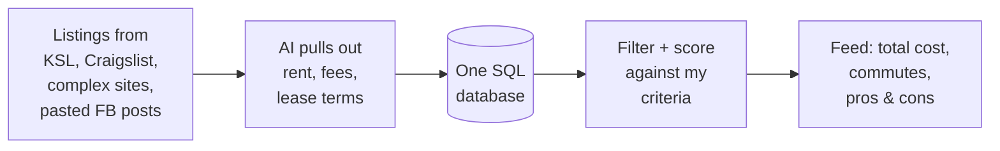
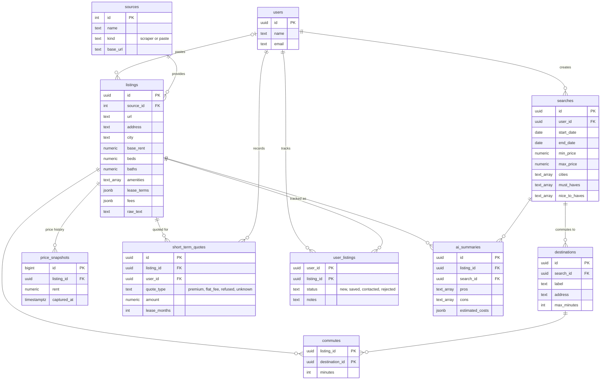
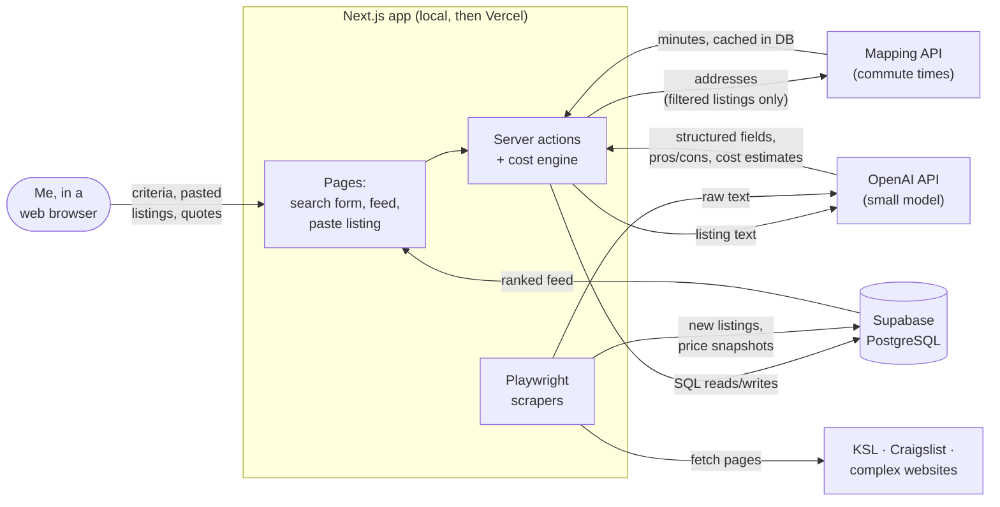

# ApartmentFinder: Project Proposal

CS 452 Final Project · Full plan in [PLAN.md](PLAN.md) · Hours in [PROJECT_LOG.md](PROJECT_LOG.md)

## Purpose

**Find a place to live for 3–6 months and see what the whole stay will really cost.**

Finding housing for a short stay is hard:

- Listings are spread across Facebook Marketplace, KSL, Craigslist, and many apartment complex websites.
- Complexes rarely post short-term prices. When you ask, they say one of three things:
  **"+$X per month"**, **"$Y flat fee"**, or **"we don't do short leases."**
- So you can't compare listings by what matters: the **total cost of the stay**.

ApartmentFinder collects listings into one SQL database, filters them against my criteria, and
shows a feed where each listing has a total cost, commute times, and an AI summary of pros and cons.



## Goals

1. **Total cost for the actual stay**: rent × months + short-term premium + one-time fees, with
   "+ ~$X est." for costs the listing doesn't mention (utilities, parking).
2. **Record a quote**: after calling a complex, enter what they said ("+$150/mo"), and the total
   updates. This also tracks which places I've contacted.
3. **Balanced commute**: rank by the *longer* of two commutes (Lehi and BYU campus), so neither
   person ends up with a long drive.
4. **Several sources in one place**: scrapers for KSL, Craigslist, and one apartment platform,
   plus paste-a-listing for Facebook (no Facebook scraping).
5. **Stay in budget**: about 30 hours of work, under $10 of AI API costs.

**Phase 1** covers Utah County only. Dallas comes later if there's time. Every table has a `user_id`, so other users can be added later without changing the schema.

## Initial ERD

Listings are shared (one row per real listing). Searches, quotes, notes, and AI summaries belong to a user.



The full SQL is in [supabase/migrations/001_schema.sql](supabase/migrations/001_schema.sql).

## System Design



| Piece | Technology | Why |
|---|---|---|
| Website + backend | Next.js (JavaScript) | One project for UI and server code |
| Database | PostgreSQL on Supabase (free) | Real SQL, plus login built in for later |
| Scraping | Playwright | Handles JavaScript-heavy apartment sites |
| AI | OpenAI API, small cheap model | Pulls fields out of messy listing text; writes pros/cons |
| Commutes | Mapping API, free tier | Called only for listings that pass the filters, then cached |

## Daily Goals (11/17 – 12/9)

Done so far (11/16): plan, repo, Next.js app, 10-table schema in Supabase, seed data, DB health check. (3 hrs)

| Date | Goal | Milestone | Est. hrs |
|---|---|---|---|
| Tue 11/17 | Search criteria form: dates, price, beds/baths, cities | 2 | 1.5 |
| Wed 11/18 | Must-haves / nice-to-haves + Lehi & BYU destinations; save to DB | 2 | 1.5 |
| Thu 11/19 | Paste-a-listing page (URL or text) | 3 | 1.5 |
| Fri 11/20 | AI extraction → listing row (rent, fees, lease terms, amenities) | 3 | 2 |
| Sat 11/21 | Test extraction on 10 real listings; fix bad fields | 3 | 1.5 |
| Mon 11/23 | Cost engine: total for the stay for each short-term pricing case | 4 | 2 |
| Tue 11/24 | "Record a quote" form; totals recalculate | 4 | 1.5 |
| Wed 11/25 | Buffer / catch up | — | 1 |
| Thu–Fri 11/26–27 | Thanksgiving, off | — | 0 |
| Sat 11/28 | Feed page: listing cards with cost breakdown | 5 | 2 |
| Mon 11/30 | Filters, scoring by nice-to-haves, saved/contacted/rejected status | 5 | 2 |
| Tue 12/1 | AI pros/cons + "+ ~$X est." undisclosed costs | 6 | 2 |
| Wed 12/2 | Craigslist (Provo/Orem) scraper | 7 | 1.5 |
| Thu 12/3 | KSL rentals scraper | 7 | 1.5 |
| Fri 12/4 | One apartment-platform scraper (RentCafe or Entrata) | 7 | 1.5 |
| Sat 12/5 | Commute times (cached) + balanced-commute ranking | 8 | 1.5 |
| Mon 12/7 | Deploy to Vercel; fix bugs | 8 | 1 |
| Tue 12/8 | Write FINAL_REPORT.md, screenshots | 8 | 1 |
| Wed 12/9 | Demo video, submit, add repo link to class list | 8 | 0.5 |
| | | **Total** | **~30** |

If I fall behind, I'll cut in this order: the apartment-platform scraper, then commute times (I'll enter them by hand), then the KSL scraper.

## Rough UX Sketches

**Feed**

```
┌──────────────────────────────────────────────────────────────────┐
│ ApartmentFinder    Search: Utah County, Jan 5 – Jun 30 (6 mo) ▾  │
│ Filters: $≤1600 · 1+ bd · Orem, AF, PG, Lindon · ≤30 min         │
│ Sort: [Total cost ▾]                     [+ Paste a listing]     │
├──────────────────────────────────────────────────────────────────┤
│ The Village at Orem · 1bd/1ba · Orem              ★ Saved        │
│ $1,350/mo  →  TOTAL $9,050 for 6 mo  + ~$720 est. utilities      │
│   rent $8,100 · short-term +$100/mo $600 · fees $350             │
│ 🚗 Lehi 24 min · BYU 9 min  (balanced: 24)                       │
│ ✔ in-unit W/D, gym   ✘ no dishwasher                             │
│ AI: + quiet, close to I-15   − older units, parking extra        │
│ [Record quote]  [Contacted]  [Reject]  [View source ↗]           │
├──────────────────────────────────────────────────────────────────┤
│ Basement apt (KSL) · 2bd/1ba · Pleasant Grove                    │
│ $1,200/mo  →  TOTAL $7,200+   ⚠ short-term price unknown, ask    │
│ 🚗 Lehi 15 min · BYU 22 min  (balanced: 22)                      │
└──────────────────────────────────────────────────────────────────┘
```

**Record a quote**

```
┌─────────────────────────────────────────┐
│ What did they say about a 6-month lease?│
│ ( ) +$____ per month                    │
│ ( ) $____ flat fee                      │
│ ( ) They don't allow short leases       │
│ Notes: [_____________________________]  │
│                          [Save quote]   │
└─────────────────────────────────────────┘
```
